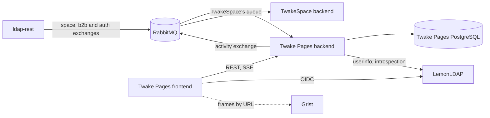
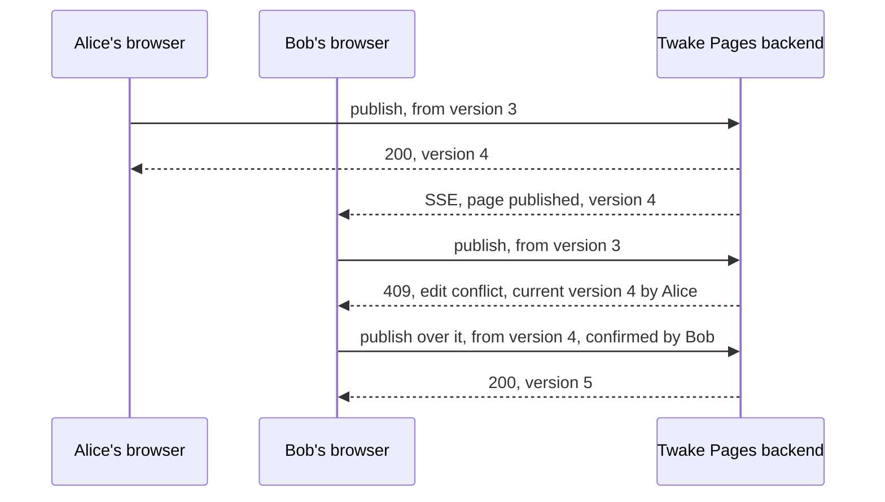

## Context

1. A team writes down what it knows: meeting notes, decisions, how-tos, specifications. Confluence keeps them as pages in a tree, one tree per team, with versions, comments and search. Twake Workplace has no such place: written knowledge ends up in Drive files and Docs documents, with no home per space.
2. Each space has tabs, and each one shows the space's resource in an app (ADR 005, ADR 010). A space needs a Pages tab.
3. People also need pages of their own, and pages shared with chosen people outside any space, in B2B and in B2C.
4. Twake Workplace has two editors already. Docs (La Suite numérique) keeps a tree of documents with access granted per document (`Document` and `DocumentAccess`), and stores each document as Yjs state in object storage, written by its editor and its y-provider server. Its API answers its own OIDC client, with a bearer token or a session, and its backend sends `frame-ancestors 'none'` by default. Its editor is BlockNote. Grist is a spreadsheet database, with its own sign in and its own access per document.
5. Twake Tasks (ADR 009) is the first app made for spaces: its own frontend, backend and database, a space integration, activity events and an embed route. Its architecture is there to reuse.

## Decision

- Twake Pages is a new standalone app, with its own frontend, backend and PostgreSQL database, listed in the Workplace like the other apps. It is built like Twake Tasks, on the same stack, and follows ADR 009 wherever this ADR says nothing else: accounts, tenant isolation, authentication, space integration, activity events and live updates.
- Pages are written with BlockNote, the editor Docs is built on, and Twake Pages stores them as BlockNote's JSON in its own database. Twake Pages does not call Docs.
- Grist documents show in pages as frames of Grist's own pages, by URL. Twake Pages does not call Grist's API and holds no Grist credentials.
- Wikis belong to people or to spaces. Spaces are not part of Twake Pages' model: a space integration module creates the wiki of each space and keeps its members in step, as in Twake Tasks.
- One deployment serves every B2B organization and every B2C user. On-prem runs the same app.
- Twake Pages works without TwakeSpace. RabbitMQ is required.

### Wikis

- A wiki is a tree of pages with its members. A member has the same role on every page of the wiki.
- Each user gets a personal wiki on first use. It is never shared.
- A user creates shared wikis and shares them with chosen people. A space's wiki has the space's members and roles, set by the space integration, and they cannot be changed in Twake Pages.
- A wiki has a name, a description and a home page. The admin of a shared wiki renames or deletes it. A deleted wiki is kept 30 days, then purged.

### Pages and the tree

- A page has a title, its content as blocks, labels, versions, comments and followers.
- A page sits under a parent page or at the top of the tree. The home page is outside the tree: the wiki opens on it, and it is never moved or deleted.
- Pages are ordered among their siblings by fractional keys, as tasks are in Twake Tasks: `text COLLATE "C"`, computed by the server from the neighbours the client names.
- A page moves with its children, within its wiki, and never under itself or one of its descendants. Every move can be done without dragging, from the page's menu and the keyboard.
- A page is either a document of blocks or a database, which shows one Grist document instead.
- Labels belong to a wiki and are given to its pages. A wiki lists its pages by label.
- A new page starts from a template: blank, meeting notes, decision, how-to, retrospective or requirements. The templates ship with the frontend.

### Writing and versions

- The editor keeps the person's changes as a draft in their browser while they type, and offers it back when they return. A draft is private and never reaches the server.
- Publishing sends the title and the blocks with the number of the version the draft started from, and records the next version in one transaction. When the page has a newer version, publishing is refused as an edit conflict, which shows who published what in between. The person then reloads the page, or publishes over the newer version, which they confirm.
- A version keeps the title, the blocks, a plain text copy for search and previews, its author and its time. The history of a page lists its versions and shows any of them. Restoring a version publishes its title and blocks again, as a new version.
- The server checks the blocks before storing them: at most 2 MiB of JSON, links only to `http:`, `https:` and `mailto:` addresses, images, videos, audio and files only at `https:` addresses, and every Grist embed on a configured Grist origin. The frontend checks the Grist origin again before framing it.
- There is no live co-editing: two people writing the same page meet an edit conflict when the second one publishes. Everyone else sees a new version as soon as it is published, through live updates.

### Trash

- Deleting a page moves it to the wiki's trash with its children, as one deleted page. An editor restores it with its children, under its parent if that is still there, at the top of the tree otherwise.
- An admin deletes a page from the trash for good, or empties the trash. A scheduler purges the pages that have spent 30 days in the trash, with the jobs table of Twake Tasks, read with `FOR UPDATE SKIP LOCKED`.

### Grist

- A database page and a Grist embed hold the address of a Grist document, or of one of its pages, on a Grist origin of the deployment (`GRIST_ORIGINS` in the backend, `GRIST_URL` in the frontend, whose image also puts them in its `frame-src`).
- Twake Pages frames that address and nothing else. Grist's own access applies inside the frame: a person who cannot open the document in Grist cannot open it in the page either.
- Grist must allow Twake Pages' origin in its `frame-ancestors`, and TwakeSpace's origin too, since in a Pages tab the Grist frame sits inside the Pages frame and the browser checks every ancestor.
- Grist signs in on its own origin. Each Grist frame comes with a link that opens the document in Grist, which is where a person without a Grist session signs in.

### Following and notifications

- A comment is on a page, or a reply to a comment. Its author edits or deletes it, and an admin deletes any. Writing `@` and a member's email in a comment mentions them.
- The person who creates a page follows it, and so does each person who publishes it, comments on it or is mentioned in it. Anyone can follow or unfollow a page.
- Twake Pages notifies followers itself, in the app, of new versions and comments, and the people mentioned with the reason `mentioned`. The person who acted is never notified. TwakeSpace makes no notification from page events.
- Each user marks pages as favorites, and finds the pages they opened lately in Recent.

### Search

- Search covers the titles and the text of the current version of every page in the user's wikis, ranked, with an excerpt around the words found.
- It is PostgreSQL full text search with the `simple` configuration, since a wiki mixes languages, and the last word typed matches as a prefix.

### Access

- Three roles, as in Twake Tasks. A viewer reads, comments, follows and keeps favorites. An editor also creates, publishes, moves, deletes and restores pages, and manages labels. An admin also renames and deletes the wiki, manages its members and deletes pages for good.
- The creator of a shared wiki is its admin.
- Sharing works as in Twake Tasks: by email, in B2B within the organization with autocomplete, in B2C between B2C users by full email. Sharing always answers "invited", and the invitation becomes a membership when that email signs in.
- Every permission check goes through one function.

### Space integration

- As in Twake Tasks: a module of the backend, turned off where there are no spaces, the only code that knows space ids. It consumes the `space` exchange from its own queue and deduplicates on `messageId`.
- On `twake.space.created`, it creates the space's wiki, named after the space, with its home page, and publishes `com.twake.pages.space.provisioned.v1` with the kind `wiki` and the wiki id. Replayed, it finds the wiki from the space id, creates nothing and publishes the same event again.
- On member events, it sets the person's role in the wiki from their role in the space. A person removed from the space leaves the wiki and stops getting its notifications. Their pages and comments stay.
- Renaming the space renames the wiki.
- On `twake.space.deleted`, the wiki becomes inaccessible, is kept 30 days, then deleted.
- It repairs the wikis from `twake.space.synced` and `twake.space.sync.completed`, and requests a sync of every organization at its first deployment (ADR 005, Decision).

### Inside TwakeSpace

- The Pages tab of a space frames Twake Pages on `/embed/wikis/<wiki id>`: the wiki, its tree and its pages, without Twake Pages' own bar and navigation. Below the route, the paths are `/pages/<page id>`, `/search` and `/trash`.
- It follows ADR 010, section "One contract for every app", with `@linagora/twake-embed`: `path`, `load` and `navigate`, the overlay page `/embed/overlay.html`, and `login-required` when the silent login is refused.
  - Its dialogs and temporary drawers are drawn on the overlay page, with the menus opened in them. A menu opened in the frame stays in the frame, as in Twake Tasks: no message of ADR 010 tells the frame where it sits on the page of TwakeSpace.
  - Once it reports `login-required`, it shows that the session expired while TwakeSpace signs the person in again and reloads the page.
- Twake Pages allows framing only by itself and by the TwakeSpace origin, set from its configuration.
- The tab badge of a wiki is the number of the user's unread notifications about its pages, reported for every wiki the user belongs to.
- A feed card about a page opens the Pages tab of its wiki at that page.
- Twake Pages follows the user's language and theme from the common settings by itself, as Twake Tasks does.

### Live updates

- As in Twake Tasks: one SSE stream per wiki shown, opened with `fetch` and the bearer token. Each wiki has a version, increased in the same transaction as every change to its pages, tree, labels, members and comments. PostgreSQL `NOTIFY` carries the wiki id and the version to every replica. A gap in versions, or a reconnection, reloads the wiki.

### Activity events

- Published as in Twake Tasks, through an outbox, with `twakeactorid`, `twakeactor`, and `twakeorg` on B2B events. `data.object` is the page: type `page`, its id and title, and its wiki as `container`, with the kind `wiki`.
- Events, as `com.twake.pages.page.<action>.v1`:
  - `created`, `moved`, `deleted` and `restored`
  - `published` for every version after the first, with the version number in `data.version` and the beginning of the text as `data.preview`
  - `commented`, with the comment as `data.preview` and the people mentioned in `data.recipients`, with the reason `mentioned`. For pages, this is the source of the "commented on" card that ADR 006 misses (see its Consequences).
- No activity event about a space's wiki leaves before RabbitMQ confirms its provisioned event (ADR 005, Decision).

### Later

- Live co-editing comes first after v1, on Yjs with a server of Twake Pages' own.
- Then inline comments on a passage, files and images uploaded to pages (v1 takes images by link), email notifications, links between pages with backlinks, moving pages to another wiki, templates written by users, archived wikis, restrictions on a page, public links, and import and export as Markdown, which also brings Docs documents in.

## Consequences

- A new app to build, deploy and run in SaaS and on-prem, with its own database, two LemonLDAP clients (`twakepages` and `twakepages-backend`) and one more consumer of ldap-rest's exchanges.
- TwakeSpace gets a Pages tab: an entry in its table of embedded apps (app `pages`, resource `wiki`, embed path `/embed/wikis/<id>`, overlay path `/embed/overlay.html`), `PAGES_URL` in its runtime configuration and its origin in `frame-src`. ADR 005's kinds of resources and ADR 006's events per app get Twake Pages.
- Twake Pages and Docs share an editor, not documents: a page is BlockNote JSON in Twake Pages' database, a Docs document is Yjs state in Docs' storage. Moving content from one to the other is an import or an export.
- Without live co-editing, the second of two people writing the same page has to choose between reloading and overwriting. A draft lives in one browser, and does not follow its author to another device.
- Grist frames depend on Grist's deployment: its `frame-ancestors` must allow Twake Pages and TwakeSpace, and a reader needs a Grist session and access to the document. Twake Pages cannot tell who can open a framed document, so a page can show a frame that some of its readers cannot open.
- Search finds words and their beginnings, not their other forms: the `simple` configuration knows no language.
- Twake Pages holds the pages of every organization and B2C user in one database, isolated as in Twake Tasks.

## Alternatives considered

- Building the wiki on Docs, each page a Docs document in Docs' own tree. Rejected, for more constraints than benefits. Docs grants access per document, so a space's wiki would need its accesses kept in step with the space on every document, a second permission source next to the space integration. Its content is Yjs state, so search, previews, versions and activity events would need its y-provider to convert it. Its API trusts its own client, so Twake Pages' backend would need a token exchange for every call. Reusing its editor keeps the writing experience and the content format.
- Docs' frontend for writing, framed in Twake Pages. Rejected for the same reasons, and it adds a third level of frames in TwakeSpace, with its own silent login and `frame-ancestors`.
- Pages in Grist, a table of pages with a rich text column. Rejected: Grist cells are not documents, and Grist grants access per document, not per row.
- Calling Grist's API to create a document for each database page and share it with the wiki's members. Rejected for v1: an API key that acts in every organization's Grist, a mapping from Workplace organizations to Grist teams that does not exist yet, and a second permission source to keep in step. Framing by URL leaves Grist the owner of its documents and their access.
- Live co-editing from the start, with Yjs state as the source of truth, as in Docs. Postponed: it needs a WebSocket server, and makes versions, search and activity events derived from Yjs state. Versions with an edit conflict check come first, and co-editing will build on the same editor.
- Drafts stored on the server. Rejected for v1: a server draft is private data that only its author reads, with a purge of its own. Co-editing will replace drafts.
